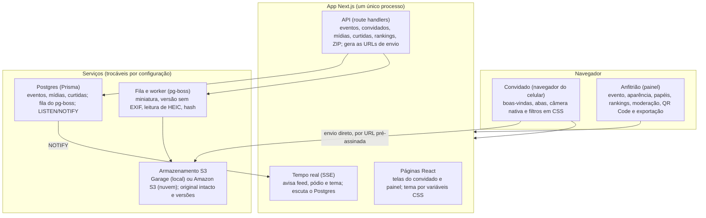
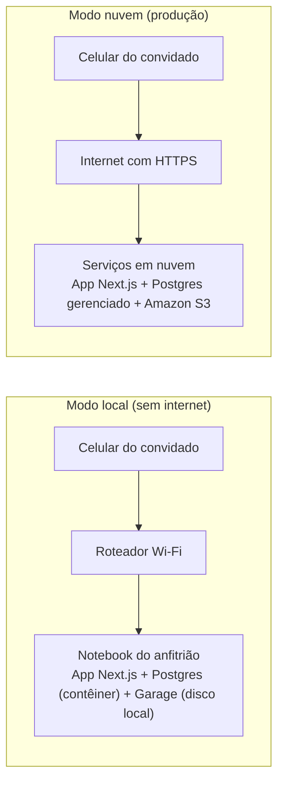

# Especificação técnica do protótipo

O protótipo é uma única aplicação Next.js, com Postgres (via Prisma) e armazenamento compatível com S3. Ela roda do mesmo jeito no notebook do anfitrião, sem internet, ou num servidor na nuvem, e o modo é escolhido por configuração.

## Requisitos

Os requisitos incorporam a personalização do evento pelos anfitriões, a entrada do convidado em quatro etapas e as abas da rede social. O que ainda depende de decisão está marcado como "a definir".

### Funcionais

| ID | Requisito | Quem usa | Prioridade |
| --- | --- | --- | --- |
| RF01 | Criar e editar o evento: nome, data e capa | Anfitrião | Essencial |
| RF02 | Personalizar a aparência: tema de cores, fonte (lista pré-definida) e estilo do feed (lista, grade ou mural) | Anfitrião | Essencial |
| RF03 | Definir os papéis que o convidado pode escolher: convidado, padrinho ou madrinha, família, amigos etc. | Anfitrião | Essencial |
| RF04 | Ligar ou desligar o ranking de curtidas e o ranking de fotos enviadas | Anfitrião | Essencial |
| RF05 | Gerar e imprimir o QR Code do evento | Anfitrião | Essencial |
| RF06 | Moderar publicações: ocultar depois ou aprovar antes | Anfitrião | Essencial |
| RF07 | Exportar o acervo completo em ZIP, com os arquivos originais | Anfitrião | Essencial |
| RF08 | Entrar em quatro etapas: nome, papel, avatar (conjuntos descontraído e discreto) e acesso à rede social | Convidado | Essencial |
| RF09 | Enviar fotos da galeria ou tirar pelo próprio app, com filtros | Convidado | Essencial |
| RF10 | Curtir e descurtir fotos, com uma curtida por convidado em cada foto | Convidado | Essencial |
| RF11 | Navegar pelas abas Fotos (ordenadas por curtidas, no estilo Reddit), Pódio e Minhas fotos | Convidado | Essencial |
| RF12 | Excluir as próprias fotos | Convidado | Desejável |
| RF13 | Exibir as fotos novas num telão | Anfitrião | Desejável |
| RF14 | Enviar vídeos | Convidado | A definir |

### Não funcionais

| ID | Requisito | Como verificar |
| --- | --- | --- |
| RNF01 | O mesmo código roda em dois modos de implantação, local (sem internet) e nuvem, escolhidos por configuração | Subir os dois modos com a mesma imagem Docker |
| RNF02 | Sem instalação de app; funcionar no Safari do iPhone e no Chrome do Android | Matriz de compatibilidade |
| RNF03 | Suportar 150 convidados, com pico de 30 envios simultâneos (a definir) | Teste de carga com k6 |
| RNF04 | Preservar o arquivo original; os filtros não podem alterá-lo | Comparar o hash SHA-256 no celular e no servidor |
| RNF05 | No modo local, rodar em hardware comum, como um notebook ou um Raspberry Pi | Medir CPU e memória durante o teste de carga |
| RNF06 | Retomar o envio após uma queda do Wi-Fi | Derrubar a rede no meio de um envio |
| RNF07 | Fontes, avatares e demais recursos embutidos no app, sem depender de CDN | Rodar o modo local com o roteador sem internet |
| RNF08 | Convidados recebem versões sem metadados de localização; o original fica só com os anfitriões (LGPD) | Inspecionar o EXIF das imagens servidas |
| RNF09 | Interface em português do Brasil (padrão) e inglês, escolhida pelo idioma do celular e trocável na própria página, ou fixada pelos anfitriões para o evento | Abrir o app com o celular configurado em cada idioma e trocar pelo seletor; fixar um idioma no painel |

## Arquitetura

A arquitetura tem três camadas: o navegador, o app Next.js e os serviços de apoio. Os serviços são trocáveis por configuração, o que permite rodar o mesmo app no notebook ou na nuvem.

### Componentes

O celular envia o arquivo direto ao armazenamento, por uma URL gerada pela API. O worker cria as versões de exibição, e o Postgres avisa o tempo real a cada mudança.

### Modos de implantação

Nos dois modos, o celular fala com a mesma aplicação; muda apenas onde ficam o banco e os arquivos. A imagem Docker é a mesma, e o modo é escolhido por variáveis de ambiente.

### Decisões

- **Aplicação única em Next.js:** páginas, API e tempo real (SSE) no mesmo processo.
- **Postgres com Prisma nos dois modos:** em contêiner no notebook ou gerenciado na nuvem, com as mesmas migrações.
- **Armazenamento com duas opções:** no modo local, o Garage roda no próprio notebook e grava os arquivos no disco dele; no modo nuvem, os arquivos vão para o Amazon S3 (ou similar). Os dois usam a mesma interface (a API do S3), então o código do app é o mesmo. O Garage ocupa o lugar do MinIO, sugerido antes, porque a edição gratuita do MinIO deixou de ser mantida ([fonte](https://dev.to/rosgluk/minio-ce-in-2026-retired-upstream-source-only-and-what-to-use-1k02)).
- **Envio direto ao armazenamento:** por URL pré-assinada, em partes e retomável, sem passar o arquivo pela aplicação.
- **Processamento em segundo plano com pg-boss:** miniatura, versão de exibição sem metadados, leitura de HEIC e hash, numa fila guardada no próprio Postgres.
- **Tempo real com SSE e LISTEN/NOTIFY:** cada foto nova, curtida ou mudança de tema gera um aviso no Postgres, que chega a todos os celulares, mesmo com várias instâncias na nuvem.
- **Personalização sem código:** a aparência do evento é um JSON validado, aplicado como variáveis CSS; fontes e avatares vêm embutidos no app.
- **Interface bilíngue:** os textos da interface ficam em dicionários, em português do Brasil (padrão) e inglês, e as páginas ficam sob `/pt-BR` e `/en`. O endereço do QR Code não tem idioma: o app usa o idioma escolhido antes ou, na primeira visita, o do celular. Os anfitriões podem fixar o idioma dos convidados de um evento; nesse caso, todas as telas do evento ficam nele, e os links de troca somem. O que os anfitriões digitam, como os nomes dos papéis, não é traduzido.
- **Filtros não destrutivos:** o filtro é aplicado na exibição com CSS, e o original nunca é recomprimido.
- **Configuração por variáveis de ambiente:** modo, endereço público, banco e armazenamento.
- **Rede local:** roteador dedicado, com o QR Code apontando para o IP fixo do notebook.

## Modelo de dados

O banco é Postgres, modelado com Prisma, e as mesmas migrações valem para os dois modos. Os identificadores são UUID, para que um evento criado localmente possa ser levado para a nuvem sem conflito.

| Entidade | Campos principais | Observações |
| --- | --- | --- |
| Anfitrião | id, nome, e-mail, hash da senha | Um evento pode ter mais de um anfitrião (tabela de ligação) |
| Evento | id, slug, nome, data, capa, aparência, idiomaConvidados, rankingCurtidas, rankingFotos, modoModeracao, status | Aparência em JSON (cores, fonte, estilo do feed), validada com Zod antes de salvar; idiomaConvidados vazio deixa o celular de cada convidado escolher |
| Papel | id, evento, nome, ordem | Lista editável pelos anfitriões |
| Convidado | id, evento, nome, papel, avatar, hash do token, criado em | Sem senha, identificado pelo cookie; avatar é uma referência a um conjunto embutido, como "descontraido/12" |
| Mídia | id, evento, convidado, tipo, origem (câmera ou galeria), chave do original, chave da exibição, chave da miniatura, filtro, MIME, tamanho, dimensões, SHA-256, data de captura (EXIF), status, total de curtidas, criada em | O filtro é guardado como dado, não aplicado ao arquivo; o total de curtidas fica na própria mídia, com índice, para ordenar rápido |
| Curtida | mídia, convidado, criada em | Chave composta (mídia, convidado) impede curtida dupla |

## Fluxos principais

Os fluxos são os mesmos nos dois modos; muda apenas onde ficam o banco e os arquivos.

**Entrada do convidado**

1. O convidado escaneia o QR Code e abre a página do evento, já com o tema escolhido pelos anfitriões.
2. Na tela de boas-vindas, informa o nome.
3. Escolhe o papel: convidado, padrinho, família etc.
4. Escolhe um avatar, no conjunto descontraído ou no discreto.
5. Entra na rede social. O servidor cria o convidado e grava o token num cookie.

**Envio de foto**

1. O convidado toca em "+" e escolhe entre tirar a foto ou pegar da galeria.
2. Escolhe um filtro, aplicado só na exibição; o arquivo original não muda.
3. O app pede ao servidor uma URL de envio e manda o original direto para o armazenamento, em partes, retomando se a rede cair.
4. O servidor registra a mídia e coloca o processamento na fila: miniatura, versão de exibição sem metadados e hash.
5. A foto é publicada ou, se os anfitriões configuraram aprovação prévia, vai para a moderação.
6. O servidor avisa todos os celulares conectados, e a foto aparece no feed.

**Curtida e ranking**

1. O convidado toca no coração. O servidor grava ou remove a curtida e atualiza o total da foto na mesma transação.
2. O aviso chega aos celulares, que atualizam a contagem, a ordenação da aba Fotos e o Pódio.

**Personalização**

1. O anfitrião altera tema, fonte, estilo do feed, papéis ou rankings no painel.
2. A mudança é salva no evento e chega aos convidados conectados sem recarregar a página.

**Exportação e migração**

1. O anfitrião baixa um ZIP com os originais, em pastas por papel e por convidado.
2. Opcionalmente, leva um evento local para a nuvem: cópia do banco e espelhamento dos arquivos para o bucket.

## Interface

O convidado passa por três telas de entrada e chega a uma rede social com três abas; o anfitrião tem um painel separado.

**Convidado**

1. Boas-vindas: nome do evento, capa e campo de nome.
2. "Quem é você?": papéis em botões grandes.
3. Avatar: grade com dois conjuntos, Descontraído e Discreto.
4. Rede social, com barra de abas na parte de baixo:
   - **Fotos:** cards com avatar, nome, papel, foto e curtidas, ordenados por Em alta, Mais curtidas ou Recentes.
   - **Pódio:** as 3 fotos mais curtidas e os 3 convidados que mais enviaram fotos. Cada bloco aparece só se o ranking estiver ligado, e a aba some se os dois estiverem desligados.
   - **Minhas fotos:** grade das próprias fotos, com o status de cada uma (enviando, em moderação ou publicada).
   - **Botão "+" flutuante:** Tirar foto ou Escolher da galeria, seguido da tela de filtros com prévia.

**Anfitrião**

1. Evento: nome, data e capa.
2. Aparência: tema, fonte e estilo do feed, com a prévia de um celular ao lado.
3. Participação: papéis, conjuntos de avatar liberados e rankings.
4. QR Code e impressão.
5. Moderação.
6. Exportação.

**Princípios:** pensar primeiro no celular, enviar com um toque e escrever em português do Brasil, com versão em inglês. O editor de tema deve impedir combinações de cores ilegíveis.

## Implementação e testes

A implementação segue cinco fases, começando pelo modo local, que é o mais restritivo; cada teste está ligado a uma questão norteadora.

### Stack

| Camada | Tecnologia | Observação |
| --- | --- | --- |
| Aplicação | Next.js (App Router) e TypeScript | Páginas, API e tempo real (SSE) no mesmo processo |
| Estilo e temas | Tailwind com variáveis CSS | O tema do evento vira variáveis CSS em tempo de execução |
| Idiomas | Dicionários próprios e rotas por idioma do Next.js | Português do Brasil (padrão) e inglês, sem biblioteca externa |
| Banco | Postgres com Prisma | Mesmas migrações nos dois modos |
| Tarefas em segundo plano | pg-boss | Fila sobre o próprio Postgres, sem Redis |
| Imagens | sharp | Miniatura e versão de exibição; HEIC exige uma biblioteca extra |
| Envio | Uppy, com envio multipart para S3 | Retomável; o mesmo código serve ao Garage e ao Amazon S3 |
| Armazenamento local | Garage (ou SeaweedFS) | Substitui o MinIO, cuja edição comunitária deixou de ser mantida |
| Avatares | Conjuntos SVG embutidos, como os do DiceBear | Conferir a licença de cada estilo |
| Implantação | Docker Compose (local) e contêiner (nuvem) | Evitar serverless, que limita conexões longas e envios grandes |
| Testes | Vitest, Playwright e k6 | Unidade, ponta a ponta e carga |
| Lint e formatação | Biome | Substitui o ESLint e o Prettier, com as regras recomendadas para Next.js e React |

### Fases

1. **Base:** esquema Prisma, criação do evento, entrada do convidado, envio pela galeria e aba Fotos, no modo local.
2. **Interação:** curtidas, ordenação, Pódio, Minhas fotos e rankings configuráveis.
3. **Personalização e câmera:** tema, fonte, estilo do feed, câmera no app e filtros.
4. **Nuvem:** implantação com Postgres gerenciado e S3, e tempo real com mais de uma instância.
5. **Validação:** testes de carga, matriz de compatibilidade e piloto.

### Testes

| Teste | O que mede | Questão norteadora |
| --- | --- | --- |
| Hash do original (SHA-256) | Se o arquivo salvo é idêntico ao do celular, mesmo com filtro aplicado | 4 |
| Carga com k6 | Vazão, latência, CPU e memória com 150 convidados e 30 envios simultâneos | 3 e 4 |
| Modo offline | Funcionamento completo com o roteador sem internet | 3 |
| Compatibilidade | iPhone com Safari, Android com Chrome e Samsung Internet, incluindo HEIC e câmera | 2 |
| Curtidas simultâneas | Total correto com muitas curtidas ao mesmo tempo, sem curtida dupla | — |
| Ponta a ponta (Playwright) | Entrada, envio, curtida, Pódio e exportação, emulando celulares | 2 |
| Piloto | Porcentagem de convidados que enviaram, tempo até o primeiro envio e questionário SUS | 2 |
| Migração local para nuvem | Evento local publicado na nuvem sem perda de dados | 3 |

## Questões técnicas em aberto

A mais urgente é a câmera no modo local: sem HTTPS, o navegador não libera a câmera dentro da página, o que afeta a captura com filtro ao vivo. As questões 1 a 3 decidem como a câmera e os filtros serão implementados e devem ser testadas na fase 1.

| # | Questão | Por que importa | Recomendação |
| --- | --- | --- | --- |
| 1 | Câmera no app sem HTTPS | No modo local, o acesso é por IP e HTTP, e o navegador só libera a câmera ao vivo em páginas seguras | Usar a câmera nativa pelo campo de arquivo, que funciona sem HTTPS, e aplicar o filtro depois da captura. Avaliar um certificado válido de domínio próprio, emitido antes do evento e apontado para o IP local |
| 2 | Filtros x qualidade original | Aplicar o filtro gera um novo arquivo e recomprime a imagem; além disso, o Safari do iPhone limita o tamanho do canvas e obriga a reduzir fotos grandes | Filtro não destrutivo: guardar só o nome do filtro e aplicá-lo na exibição com CSS. Gerar a versão filtrada apenas na exportação, se o anfitrião quiser |
| 3 | HEIC do iPhone | O iPhone pode converter para JPEG no envio, conforme o campo de arquivo é configurado, e a versão padrão do sharp não lê HEIC | Testar o comportamento no iPhone. No servidor, usar uma biblioteca que leia HEIC para gerar a miniatura, mantendo o original |
| 4 | Mesmo código local e nuvem | Plataformas serverless limitam conexões longas (SSE) e o tamanho das requisições | Implantar em contêiner nos dois modos, com envio direto ao armazenamento por URL pré-assinada e configuração por variáveis de ambiente |
| 5 | Tempo real com várias instâncias | Na nuvem, um aviso gerado numa instância precisa chegar aos celulares conectados às outras | SSE no app e LISTEN/NOTIFY do Postgres para distribuir os avisos, sem Redis |
| 6 | Algoritmo do ranking | Só o total de curtidas favorece as fotos mais antigas; o "em alta" do Reddit reduz o peso com o tempo | Oferecer Em alta (decaimento ajustado para horas, não dias), Mais curtidas e Recentes |
| 7 | Fraude no ranking | Sem conta, quem limpa os cookies vira um novo convidado e pode curtir de novo | Uma curtida por convidado em cada foto, limite de ações por aparelho e IP, e opção de desligar os rankings. Aceitar o risco residual |
| 8 | Recursos offline | Fontes e avatares carregados de CDN não funcionam sem internet | Lista curada de fontes empacotadas no build (next/font) e avatares SVG embutidos. Tema em JSON validado e aplicado por variáveis CSS, sem CSS livre |
| 9 | Celular em Wi-Fi sem internet | O celular pode avisar que a rede não tem internet, trocar para os dados móveis ou abrir uma janela de portal cativo | Testar em iPhone e Android antes do piloto e orientar os convidados no cartão do QR Code |
| 10 | Privacidade (LGPD) | A foto original traz metadados, como a localização, e envolve imagem de pessoas | Servir aos convidados só versões sem metadados, deixar o original apenas com os anfitriões e avisar sobre o uso das imagens nas boas-vindas |
| 11 | Vídeos | Vídeos pesam na rede local, e convertê-los exige muito processamento do notebook | Decidir se entram no protótipo. Se entrarem, limitar duração e tamanho e gerar só uma imagem de capa, sem conversão |
| 12 | Levar o evento local para a nuvem | O anfitrião pode querer publicar o acervo depois da festa | IDs em UUID, cópia do banco (pg_dump) e espelhamento dos arquivos para o S3 |
